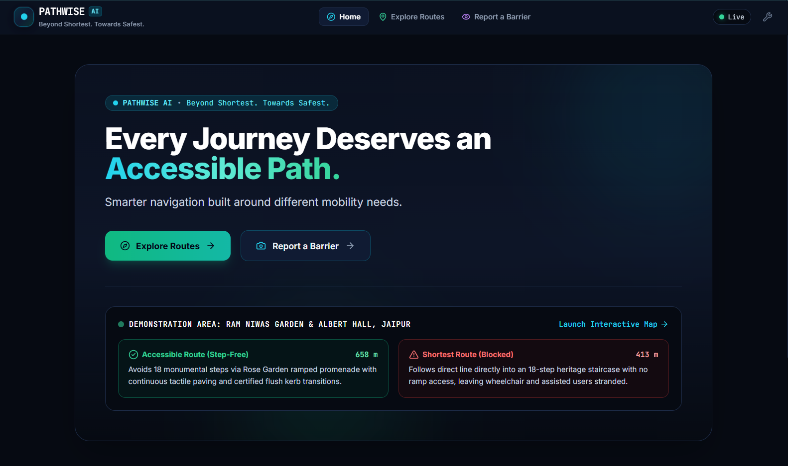
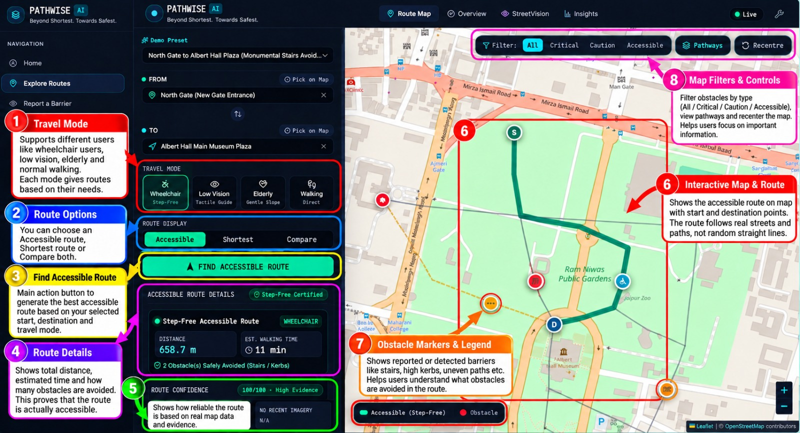
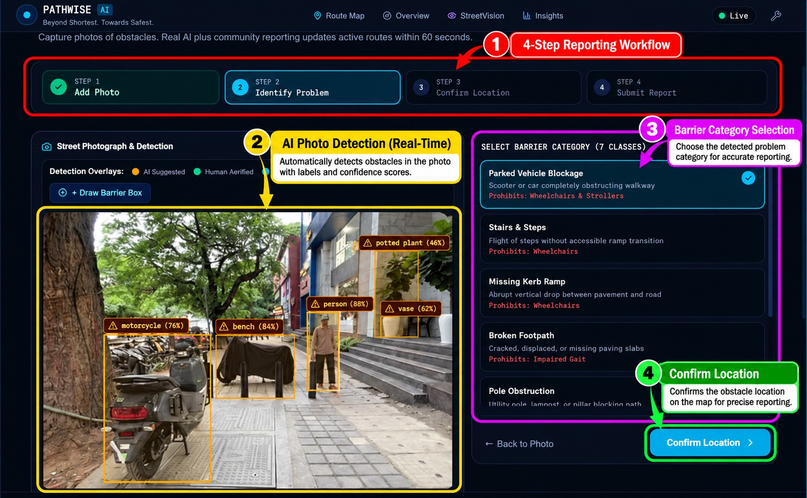

<div align="center">

# PATHWISE AI ♿

### Beyond Shortest. Towards Safest.

**An AI-powered accessibility-aware pedestrian navigation platform.**

Developed for **HypNexis 2026 | Manipal University Jaipur**

**Problem Statement: SC-02 — Accessible Walking Routes from Street Imagery**

Original Problem Statement + Phase 2 Extension

<br>

### 🚀 [EXPLORE LIVE APPLICATION](https://path-wise-ai-one.vercel.app/)

[](https://path-wise-ai-one.vercel.app/)
[](https://pathwise-ai-backend-vog9.onrender.com/api/health)


</div>

---

## 🌍 The Problem

**The shortest route is not always the most accessible route.**

Conventional navigation platforms primarily optimise distance and travel time. However, pedestrians with different mobility needs can encounter barriers that ordinary navigation systems may not adequately represent.

A wheelchair user might encounter stairs or a missing kerb ramp. A blind or low-vision pedestrian may face poles, parked vehicles or obstructed walkways. An elderly pedestrian may struggle with uneven surfaces or steep inclines.

Even a previously accessible route can become unusable because of a temporary obstruction.

PATHWISE AI addresses this gap by incorporating **street-level accessibility evidence into pedestrian route planning.**

---

## 💡 Our Solution

PATHWISE AI combines computer vision, citizen reporting, pedestrian-network intelligence and mobility-specific routing into a unified navigation platform.

Instead of recommending a path based on distance alone, the system considers known accessibility barriers and calculates alternative routes according to the selected pedestrian profile.

### How PATHWISE AI Works

**Detect → Locate → Update → Reroute → Explain**

1. **Detect:** Identify potential accessibility barriers using street photographs and citizen reports.
2. **Locate:** Associate a confirmed barrier with the relevant pedestrian-network segment.
3. **Update:** Incorporate active barriers into the routing graph.
4. **Reroute:** Calculate routes using mobility-specific accessibility costs.
5. **Explain:** Present route comparisons, known obstacles and evidence-confidence information.

Our objective is not simply to display another route on a map, but to help users understand **why a particular route is recommended.**

---

## 🌐 Live Deployment

PATHWISE AI is publicly deployed and available for demonstration.

| Service | Live Link |
|---|---|
| 🚀 Frontend Application | [Launch PATHWISE AI](https://path-wise-ai-one.vercel.app/) |
| ⚙️ Backend API | [FastAPI Backend](https://pathwise-ai-backend-vog9.onrender.com) |
| 🩺 Backend Health Check | [Check API Health](https://pathwise-ai-backend-vog9.onrender.com/api/health) |
| 📖 Interactive API Documentation | [Swagger UI](https://pathwise-ai-backend-vog9.onrender.com/docs) |
| 💻 Source Code | [GitHub Repository](https://github.com/abhaysharma-11/PathWise_AI) |

### Deployment Architecture

- **Frontend:** Vercel — React, TypeScript and Vite
- **Backend:** Render — Python, FastAPI and NetworkX
- **Computer Vision:** Ultralytics YOLOv8 Nano
- **Database:** SQLite (prototype storage)

> **Hosting Note:** The backend uses a free hosting instance and may take approximately one minute to respond after inactivity.
>
> The application currently demonstrates accessibility-aware routing within a curated Jaipur prototype area. Evidence confidence does not guarantee physical safety.

---

## 🖥️ Prototype Output & Application Preview

The following screenshots showcase PATHWISE AI's interface, accessibility-aware route planning and StreetVision reporting workflow.

### 1. Home — Every Journey Deserves an Accessible Path

A minimal, user-focused landing experience introducing PATHWISE AI and its mission.



### 2. Explore Routes — Beyond the Shortest Path

The interactive Route Explorer combines four mobility profiles, shortest-versus-accessible route comparison, obstacle visualisation and evidence-based route confidence.



### 3. StreetVision AI — See It. Report It. Improve the Route.

StreetVision combines supported AI object detection with human-assisted barrier identification and a four-step citizen-reporting workflow.

**Add Photo → Identify Problem → Confirm Location → Submit Report**



---

## ✨ Key Features

### 1. Accessibility-Aware Pedestrian Routing

PATHWISE AI uses a NetworkX-based pedestrian graph with Dijkstra routing and profile-specific edge weighting.

Users can explore three route display modes:

- **Accessible Route:** Recommended route based on the selected mobility profile.
- **Shortest Route:** Distance-oriented pedestrian route.
- **Compare Both:** Visual comparison of the calculated alternatives.

The application communicates relevant barriers, route distances and accessibility considerations.

### 2. Four Mobility Profiles

Different pedestrians experience the same street differently.

PATHWISE AI supports four mobility profiles with distinct routing preferences and restrictions.

| Mobility Profile | Routing Considerations |
|---|---|
| ♿ Wheelchair / Stroller | Step-free routing; restricts confirmed stairs, missing kerb ramps and impassable barriers |
| 👁️ Blind / Low Vision | Prioritises available tactile-guidance evidence and clear pedestrian paths; penalises relevant obstructions |
| 🤝 Elderly / Assisted | Strongly discourages stairs, steep inclines and known tripping hazards |
| 🚶 General Pedestrian | Prioritises shorter valid walking routes with basic pedestrian constraints |

Each profile uses accessibility-aware edge costs in the pedestrian-routing graph.

Different profiles may occasionally return the same route when that is optimal according to the available network and evidence.

### 3. StreetVision AI — Barrier Identification

StreetVision combines computer vision with human-assisted accessibility reporting.

The implementation uses a pretrained YOLOv8 Nano model for supported object-detection classes, including relevant vehicles, motorcycles and bicycles.

For accessibility conditions that generic object detection cannot reliably establish, users can manually identify or correct the barrier category.

**Seven supported reporting categories:**

1. Stairs
2. Missing Kerb Ramp
3. Broken Footpath
4. Missing Footpath
5. Pole Obstruction
6. Parked Vehicle
7. Uneven Surface

Reports distinguish between three evidence sources:

| Classification | Meaning |
|---|---|
| AI Suggested | A potential detection generated by the supported model |
| Human Confirmed | A report reviewed and confirmed by a user |
| Manually Reported | A barrier identified directly by a user |

This distinction prevents automated suggestions from being presented as verified accessibility facts.

### 4. Citizen Reporting & Dynamic Route Updates

Users can contribute accessibility information through a streamlined reporting workflow:

**Add Photo → Identify Problem → Confirm Location → Submit Report**

The reporting workflow supports image-location metadata where available, including EXIF GPS extraction using `piexif`.

Submitted reports are stored in SQLite and incorporated into a dynamic NetworkX graph overlay without modifying the underlying baseline geometry.

The frontend uses eight-second barrier polling to support the Phase 2 objective of reflecting accepted reports within one minute.

### 5. Temporary Barrier Expiration

Not every accessibility barrier is permanent.

A parked scooter, delivery vehicle or temporary construction obstruction may disappear after a short period.

PATHWISE AI supports configurable temporary-report durations:

| Expiration Option | Purpose |
|---|---|
| 60 seconds | Live hackathon demonstration |
| 1 hour | Short-term obstruction |
| 24 hours | Temporary daily obstruction |
| 7 days | Longer temporary condition |

Expired barriers are marked inactive and removed from the active routing overlay.

This allows subsequent route calculations to use the restored baseline network where appropriate.

### 6. Honest Route Confidence

PATHWISE AI distinguishes between a route recommendation and the strength of the accessibility evidence supporting it.

The implemented confidence calculation uses a deterministic, length-weighted evidence formula:

```text
Score = round(100 × (0.60 × R_imagery + 0.40 × R_verified))
```

Where:

- `R_imagery` represents length-weighted recent-imagery coverage.
- `R_verified` represents length-weighted verified-evidence coverage.

**Evidence classifications:**

| Score | Classification |
|---|---|
| 75–100 | High Evidence |
| 45–74 | Moderate Evidence |
| Below 45 | Limited Evidence |

The system also reports:

- Total traversed route segments.
- Segments with recent imagery.
- Segments without recent street imagery.
- Relevant verification and evidence information.

The recent-imagery threshold is configured as 90 days.

> **Safety Disclaimer:** Confidence reflects available accessibility evidence, not a guarantee of physical safety.

---

## 🏗️ Technology Stack

| Layer | Technologies |
|---|---|
| Frontend | React 18, TypeScript, Vite, Tailwind CSS |
| Mapping Interface | Leaflet 1.9, OpenStreetMap |
| Navigation | React Router v6 |
| UI Components | Lucide React |
| Backend | Python 3.12.10, FastAPI, Uvicorn |
| Routing Engine | NetworkX, Dijkstra Algorithm |
| Database | SQLite3 |
| Data Validation | Pydantic v2 |
| Computer Vision | Ultralytics YOLOv8 Nano, PyTorch |
| Image Processing | Pillow, Piexif |
| Geospatial Calculations | Haversine Geodesic Mathematics |

### System Architecture

```text
                    PATHWISE AI
                         |
                  React + TypeScript
                         |
                  Leaflet / OSM Map
                         |
                    FastAPI REST
                         |
           +-------------+-------------+
           |             |             |
      Route Engine   StreetVision   Reporting API
           |             |             |
        NetworkX     YOLOv8 Nano     SQLite3
           |             |             |
           +-------------+-------------+
                         |
              Active Barrier Overlay
                         |
             Mobility-Specific Routing
                         |
           Route Comparison + Confidence
```

---

## 📍 Demonstration Area

### Ram Niwas Garden & Albert Hall Cultural Precinct

**Jaipur, Rajasthan, India**

Approximate reference coordinates:

```text
26.9124, 75.8193
```

PATHWISE AI uses a limited, curated Jaipur demonstration network to illustrate its accessibility-routing workflow.

Demonstration annotations and scenario-specific accessibility information should not be interpreted as a comprehensive, independently verified accessibility survey of the entire precinct.

The architecture can be expanded as additional pedestrian-network and street-imagery evidence becomes available.

---

## 🚀 Run Locally (For Developers)

The complete source code is available in this repository.

### Prerequisites

- Python 3.12+
- Node.js 18+
- npm
- Git

### Step 1 — Clone the Repository

```bash
git clone https://github.com/abhaysharma-11/PathWise_AI.git
cd PathWise_AI
```

### Step 2 — Backend Setup

Navigate to the backend directory:

```bash
cd backend
```

Create a virtual environment:

```bash
python -m venv .venv
```

Activate it on Windows PowerShell:

```powershell
.\.venv\Scripts\Activate.ps1
```

Install backend dependencies:

```bash
python -m pip install -r requirements.txt
```

Start FastAPI:

```bash
python -m uvicorn app.main:app --host 127.0.0.1 --port 8000
```

Keep this terminal running.

### Step 3 — Frontend Setup

Open a second terminal in the project root:

```bash
cd frontend
```

Install dependencies:

```bash
npm install
```

Start the Vite development server:

```bash
npm run dev
```

The application will be available through the local development address displayed by Vite.

For public access, use the [deployed PATHWISE AI application](https://path-wise-ai-one.vercel.app/).

---

## 🧪 Automated Verification

The project includes a backend verification suite covering its core SC-02 functionality.

The suite checks:

1. Backend health.
2. Map configuration and four mobility profiles.
3. Pedestrian-network availability.
4. Shortest and accessibility-aware routing.
5. Evidence-confidence calculations.
6. Citizen barrier creation.
7. Dynamic rerouting.
8. Temporary barrier expiration.
9. Baseline route restoration.

### Run the Verification Suite

From the project root:

```powershell
cd backend
.\.venv\Scripts\python.exe test_complete_sc02.py
```

### Reported Demonstration Test Results

| Test Scenario | Reported Result |
|---|---:|
| Shortest Route | 413.3 m |
| Wheelchair Route | 658.7 m |
| Blind / Low Vision Route | 658.7 m |
| Elderly Route | 658.7 m |
| Additional Wheelchair Distance | 245.4 m |
| Route with Active Citizen Obstruction | 1074.0 m |
| Route After Barrier Expiration | 658.7 m |

The supplied verification output reports:

```text
ALL 9 COMPLETE SC-02 BACKEND VERIFICATION CHECKS
PASSED SUCCESSFULLY!
```

These results describe the supplied demonstration fixture and test run. Actual results depend on the selected route, active barriers and current dataset.

---

## 🎯 Suggested Live Demonstration

The following sequence demonstrates PATHWISE AI's core capabilities.

### Demo 1 — Shortest vs Accessible

Select a supported Jaipur demonstration journey.

Compare the shortest route with the wheelchair-accessible alternative and explain how a known stair barrier influences routing.

### Demo 2 — Different Mobility Needs

Switch between Wheelchair, Blind / Low Vision, Elderly and General Walking.

Explain how profile-specific graph costs affect route selection and why two profiles may sometimes share an optimal route.

### Demo 3 — StreetVision Reporting

Upload a demonstration street photograph.

Review the supported AI suggestion or manually select the correct accessibility barrier.

Confirm the relevant location and submit the report.

### Demo 4 — Dynamic Obstacle Rerouting

Introduce a temporary citizen-reported obstruction affecting the selected pedestrian route.

Demonstrate how the active graph overlay influences subsequent route calculations.

### Demo 5 — Automatic Expiration

Use the 60-second demonstration expiration option.

Observe the temporary barrier becoming inactive and verify that the route can return to its baseline configuration.

### Demo 6 — Evidence Transparency

Show the route-confidence information and the number of segments without recent imagery.

Explain why missing evidence must be communicated rather than hidden.

---

## 🔮 Future Scope

PATHWISE AI is currently a limited-area hackathon prototype.

Potential future extensions include:

- Expansion to additional Indian cities.
- Larger, locally annotated Indian street-imagery datasets.
- Improved accessibility-specific computer vision models.
- Broader pedestrian-network coverage.
- Community-assisted barrier verification.
- Persistent cloud-based image and report storage.
- Integration with municipal accessibility datasets.
- More detailed pedestrian-crossing and surface-condition information.

Our long-term vision is to make accessibility a fundamental consideration in everyday navigation.

---

## 🏆 Hackathon Context

**Event:** HypNexis 2026  
**Host Institution:** Manipal University Jaipur  
**Problem Statement:** SC-02 — Accessible Walking Routes from Street Imagery  
**Project:** PATHWISE AI

### Scope Covered

- Original SC-02 problem statement.
- Phase 2 extension.
- Accessibility-aware pedestrian routing.
- StreetVision-assisted citizen reporting.
- Dynamic barrier lifecycle.
- Mobility-specific routing.
- Evidence-based route confidence.

---

<div align="center">

### PATHWISE AI

**Beyond Shortest. Towards Safest.**

*Because every journey deserves an accessible path.*

**Built for HypNexis 2026 | Manipal University Jaipur**

### [🚀 Launch PATHWISE AI](https://path-wise-ai-one.vercel.app/)

</div>
